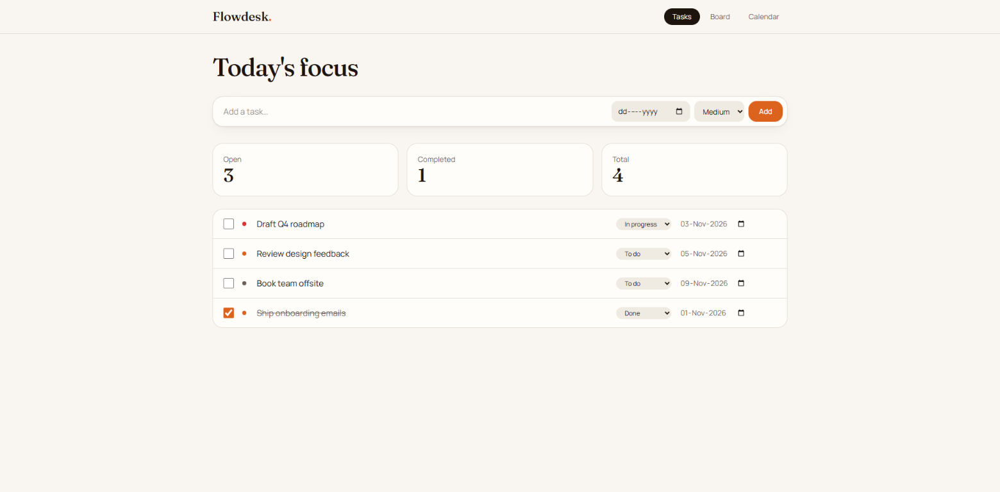
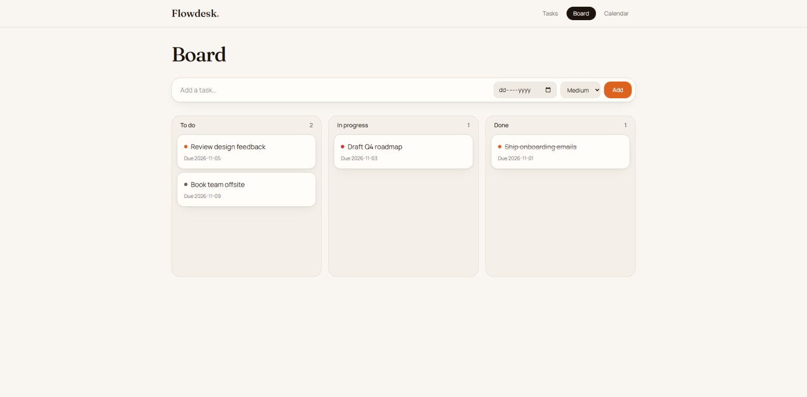
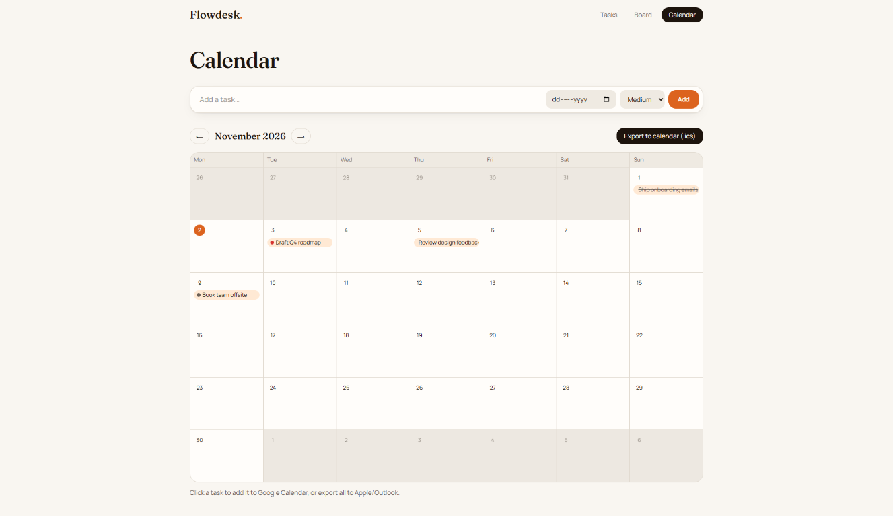

# Flowdesk

Flowdesk is a lightweight task planner for organizing work in a task list, a
Kanban board, and a monthly calendar. Set priorities and due dates, move tasks
through their workflow, and export dated tasks for use in calendar apps.

## Project preview

| Tasks | Board | Calendar |
| --- | --- | --- |
|  |  |  |

## Features

- **Tasks:** Add, edit, complete, and delete tasks; set a priority and optional
  due date; view open, completed, and total task counts.
- **Board:** Organize tasks into **To do**, **In progress**, and **Done** columns.
  Drag a task between columns to update its status.
- **Calendar:** Browse tasks by due date, open a task in Google Calendar, or
  export dated tasks as an `.ics` file for calendar apps such as Apple Calendar
  and Outlook.
- **Local persistence:** Tasks are saved in this browser's local storage. The
  app starts with example tasks when no saved task list exists.

There is no account or cloud sync: task data stays in the current browser and
isn't shared between browsers or devices.

## Tech stack

The app is built with React, TypeScript, TanStack Start and TanStack Router,
Vite, and Tailwind CSS.

## Getting started

You'll need Node.js and [Bun](https://bun.sh/). From the project directory:

```sh
bun install
bun run dev
```

Open the local URL printed by Vite in your terminal.

## Scripts

| Command | Description |
| --- | --- |
| `bun run dev` | Start the local development server |
| `bun run build` | Create a production build |
| `bun run preview` | Preview the production build locally |
| `bun run test` | Run the test suite |
| `bun run lint` | Run ESLint |

## Project structure

- `src/routes/` — File-based app routes: task list (`/`), board (`/board`), and
  calendar (`/calendar`).
- `src/components/` — Shared app shell and UI components.
- `src/lib/tasks.ts` — Task types, local-storage persistence, and task actions.
- `src/test/` — Tests.

The generated route tree is `src/routeTree.gen.ts`; it is maintained by the
TanStack Router tooling.
